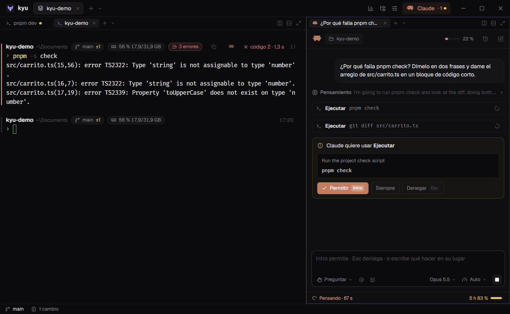

<p align="center">
  
</p>

<h1 align="center">Kyu Terminal</h1>

<p align="center">
  Terminal para Windows y Linux con Claude Code dentro.<br>
  Núcleo en Rust con Tauri 2, interfaz en React y el terminal dibujado con xterm.js.
</p>

<p align="center">
  <a href="https://github.com/IsDerky/kyu-terminal/releases/latest"></a>
  <a href="https://github.com/IsDerky/kyu-terminal/actions/workflows/ci.yml"></a>
  <a href="LICENSE"></a>
</p>

<p align="center">
  <a href="https://github.com/IsDerky/kyu-terminal/releases/latest"><b>Descargar</b></a> ·
  <a href="#terminal">Terminal</a> ·
  <a href="#claude-code">Claude Code</a> ·
  <a href="#git-y-github">Git</a> ·
  <a href="#atajos">Atajos</a> ·
  <a href="#configuración">Configuración</a>
</p>

<p align="center">
  
</p>

## Instalar

En la [última release](https://github.com/IsDerky/kyu-terminal/releases/latest):

| Sistema | Qué bajar |
|---|---|
| Windows | El instalador `.exe` (para tu usuario, sin administrador) o el `.msi`. También hay un zip portable. |
| Linux | La `.AppImage` (`chmod +x` y a ejecutar) o el `.deb`. |

Los instaladores de Windows no van firmados: SmartScreen avisa la primera vez («Más información» → «Ejecutar de todas formas»). Lo instalado mira al abrir si hay versión nueva y la ofrece en la barra de arriba; la portable y el `.deb` se actualizan a mano.

Para el panel de Claude hace falta [Claude Code](https://docs.anthropic.com/claude-code) instalado (`claude` en el PATH o su ruta en Ajustes). Lo de GitHub usa el `git` y el `gh` de tu máquina; sin ellos, el resto funciona igual.

## Terminal

- **Espacios de trabajo**: las pestañas de arriba, uno por proyecto. «Abrir carpeta…» (Ctrl+Mayús+O) crea uno fijo en esa carpeta; Kyu recuerda las recientes y, al abrir, vuelve todo como estaba.
- **Paneles**: divididos a la derecha o abajo, cada uno con sus pestañas de terminales y archivos, que se arrastran de un panel a otro.
- **Perfiles**: PowerShell, Git Bash, WSL y Símbolo del sistema se detectan solos, y cada `Host` de `~/.ssh/config` sale como perfil SSH.
- **Bloques**: cada orden lleva encima su carpeta, la rama de git y la RAM, y a la derecha el resultado, lo que tardó y la hora. Con PowerShell y bash (Git Bash, WSL, Linux).
- **Pestañas vivas**: mientras corre algo, la pestaña enseña qué (`pnpm dev`, `ssh n1`); si acaba sin que mires, se queda un punto verde o rojo.
- **Autocompletado** en gris mientras escribes: historial de la carpeta, scripts de `package.json`, ramas de git, carpetas y archivos.
- **Archivos**: Ctrl+Clic en una ruta de la salida (`src/main.rs:12:5`) la abre en el editor de Kyu en esa línea; Mayús+Clic, en VS Code. Árbol de la carpeta con el estado de git (Ctrl+Mayús+B).
- **Problemas**: tras un `tsc`, `eslint`, `cargo` o `next build`, el bloque dice cuántos errores hay y la pestaña «Problemas» los lista por archivo; cada uno se abre en su línea.
- **Servidores de desarrollo**: botón para abrir los `localhost:puerto` que salen; si el puerto está ocupado, Kyu dice qué programa lo tiene y lo cierra si se lo pides.
- **Avisos**: de Windows cuando acaba una orden larga y no estás mirando, y cuando la salida dice que ya está listo o que algo ha fallado, sin esperar al final.
- Variables de entorno de las shells, el PATH y los `.env` de la carpeta en un solo sitio (paleta → «Variables de entorno»), con los secretos tapados.
- Imágenes sixel (Kyu lleva su propio ConPTY: el de Windows se las come), grabación del panel a GIF y ajustes (Ctrl+,) que escriben en `kyu.toml` sin perder sus comentarios.

## Claude Code

Cada conversación es una pestaña más, al lado de terminales y archivos, y arranca en la carpeta del terminal con el foco. Ctrl+Mayús+C va a la última, Ctrl+Mayús+K abre otra y el botón «Claude» de la barra enseña todas: cuál trabaja y cuál espera un permiso.

- Modelo, esfuerzo y modo de permisos (Mayús+Tab), comandos con `/`, `@archivo` (también arrastrando), imágenes pegadas o soltadas y desglose del contexto.
- Permisos con el diff del cambio; los planes se aprueban desde el panel. Los archivos que cambia Claude se abren con lo cambiado marcado y se puede deshacer.
- Alt+K manda lo seleccionado en el terminal o en el editor, con su archivo y líneas.
- Varias conversaciones a la vez, mensajes en cola mientras trabaja, reanudar las anteriores y volver a un mensaje.
- Claude puede leer tus terminales y ejecutar órdenes en uno a la vista, siempre con permiso.
- Respuesta sugerida en gris tras cada turno (Tab la usa), uso por día y por proyecto, y límite diario con aviso.

### Cuentas de Claude

Varias cuentas, cada una con su sesión y el mismo historial: se cambia desde el pie del panel y la conversación sigue con la otra. El pie enseña cuánto lleva gastado la cuenta de su sesión de 5 h y de la semana, y al 90 % propone seguir con otra.

Las cuentas se añaden, se quitan y se inician **solo desde Ajustes → Claude → Cuentas**. Cada una guarda su sesión en su carpeta (`~/.claude-<nombre>`; la principal, en `~/.claude`). Un `claude auth login` lanzado a mano fuera de Kyu inicia sesión en `~/.claude` y cambia la principal.

- Quitar una cuenta solo la saca de `kyu.toml`: su carpeta y su sesión se quedan en el disco.
- Si al abrir Kyu ninguna cuenta tiene sesión, lo avisa y lleva a Cuentas; en el pie, las que no tienen salen desactivadas.

## Git y GitHub

Con el `git` y el `gh` de tu máquina (Kyu no guarda tokens):

- Barra de abajo con la rama del terminal con el foco, lo que llevas por subir o bajar (clic para hacer push), los cambios sin commit y el CI de la rama.
- Pestaña «Cambios»: diff de cada archivo, elegir qué entra, mensaje propuesto por Claude, «Revisar con Claude», commit y push.
- Aviso cuando acaba un run de GitHub Actions del repo.
- Hashes de commit y `#número` en la salida: Ctrl+Clic los abre en GitHub.
- «Trabajar en un issue»: worktree con su rama junto al repo, espacio nuevo y una conversación con el issue escrito.

## Atajos

| Atajo | Qué hace |
|---|---|
| Ctrl+Mayús+P | Paleta de órdenes |
| Ctrl+, | Ajustes |
| Ctrl+Mayús+O | Abrir carpeta como espacio |
| Ctrl+Mayús+N | Nuevo espacio |
| Ctrl+1 … Ctrl+9 | Ir al espacio n.º |
| Ctrl+Mayús+T | Nueva pestaña en el panel |
| Ctrl+Mayús+W | Cerrar la pestaña (avisa si hay cambios sin guardar) |
| Ctrl+Tab / Ctrl+Mayús+Tab | Pestaña siguiente / anterior |
| Ctrl+Mayús+D / Ctrl+Mayús+E | Dividir el panel a la derecha / abajo |
| Ctrl+Mayús+X | Maximizar el panel con el foco / volver |
| Alt+flechas | Pasar al panel de al lado |
| Ctrl+Mayús+B | Árbol de archivos |
| Ctrl+F | Buscar en el terminal |
| Tab · Ctrl+→ | Aceptar la sugerencia · palabra a palabra |
| Ctrl+Clic / Mayús+Clic en una ruta | Abrir en Kyu / en VS Code |
| Ctrl+Mayús+C | Ir a la última conversación con Claude / volver |
| Ctrl+Mayús+K | Nueva conversación con Claude |
| Mayús+Tab (en el panel) | Siguiente modo de permisos |
| Alt+K | Lo seleccionado a la caja de Claude |
| Ctrl+Mayús+G | Grabar el panel a GIF (empezar / parar) |

## Configuración

`kyu.toml` en `%APPDATA%\kyu\` (Windows) o `~/.config/kyu/` (Linux). Casi todo se cambia desde Ajustes; todo es opcional:

```toml
fuente = "JetBrainsMono Nerd Font Mono" # nombre de la familia, no la ruta al archivo
sin_prompt = false                      # true = dejar el prompt de tu perfil (oh-my-posh, starship...)
perfil_predeterminado = "PowerShell"
restaurar_sesion = true
perfiles_ssh = true                     # un perfil por cada Host de ~/.ssh/config
aviso_segundos = 10                     # 0 = sin avisos
limite_diario = 0                       # miles de tokens de salida de Claude al día; 0 = sin límite
sugerencias_claude = true

# Si pones perfiles, sustituyen a los detectados.
[[perfiles]]
nombre = "Ubuntu"
shell = "wsl.exe"
argumentos = ["-d", "Ubuntu"]
color = "#fbbf24"
icono = "linux"          # powershell, bash, linux, cmd, servidor

# Cuentas de Claude Code (mejor desde Ajustes). La que no tiene carpeta es la de siempre.
[[cuentas_claude]]
nombre = "Personal"

[[cuentas_claude]]
nombre = "Trabajo"
carpeta = "~/.claude-trabajo"
compartir = true         # historial, memoria, agentes, skills y ajustes de la principal

[tema]
fuente_tamano = 14
fondo = "#0b0b0d"
texto = "#ececf1"
cursor = "#4ade80"
seleccion = "#3b3552"
ansi = ["#1f1f24", "#f87171", "#4ade80", "#fbbf24", "#60a5fa", "#a78bfa", "#67e8f9", "#ececf1",
        "#55555e", "#fca5a5", "#86efac", "#fde68a", "#93c5fd", "#c4b5fd", "#a5f3fc", "#ffffff"]
```

## Desarrollo

Hace falta Rust estable, Node 22 y pnpm. En Windows, además, las Build Tools de Visual Studio con C++ (WebView2 ya viene con Windows 11):

```powershell
winget install --id Microsoft.VisualStudio.2022.BuildTools --override "--passive --wait --add Microsoft.VisualStudio.Workload.VCTools --includeRecommended"
winget install --id Rustlang.Rustup
```

En Debian/Ubuntu:

```bash
sudo apt install libwebkit2gtk-4.1-dev libappindicator3-dev librsvg2-dev patchelf libxdo-dev libssl-dev build-essential
```

```bash
pnpm install
pnpm tauri dev      # en desarrollo, con recarga
pnpm tauri build    # instaladores en src-tauri/target/release/bundle
```

Portable (Windows), después de `pnpm tauri build`: `powershell -File scripts/portable.ps1`. Con `kyu.portable` junto a `kyu.exe`, la configuración y los datos van a `datos\` en esa carpeta.

Publicar una versión: subir la versión en `package.json`, `src-tauri/Cargo.toml` y `src-tauri/tauri.conf.json` y empujar la etiqueta `vX.Y.Z`; el flujo `release` hace el resto.

```text
src/lib/          estado (espacios, paneles, pestañas), terminales, bloques, editores,
                  panel de Claude, problemas, sesión, órdenes al núcleo
src/componentes/  barra de título, espacio, panel, terminal, editor, árbol, Claude, ajustes
src-tauri/src/    núcleo: PTY, configuración, Claude Code (stream-json), cuentas,
                  servidor MCP de Kyu, archivos, git, puertos, entorno, GIF, uso
src-tauri/conpty/ ConPTY oficial de Microsoft (ver LEEME.md)
shell/            prompts de PowerShell y bash que Kyu carga en cada shell
bench/            medidas de arranque, memoria y salida frente a Windows Terminal
```

La primera versión, hecha con egui, está en la etiqueta `v0-egui`.

## Licencia

MIT
